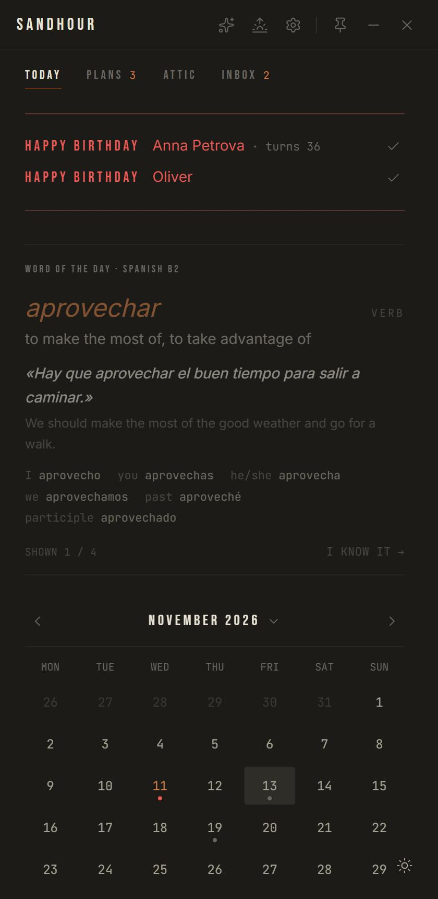
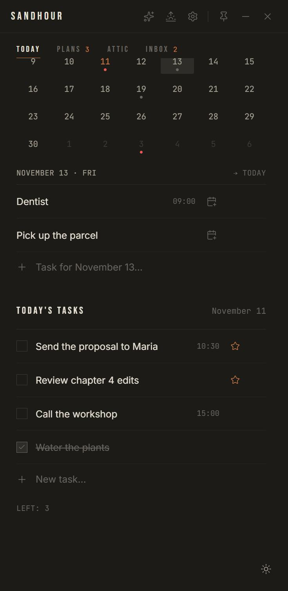
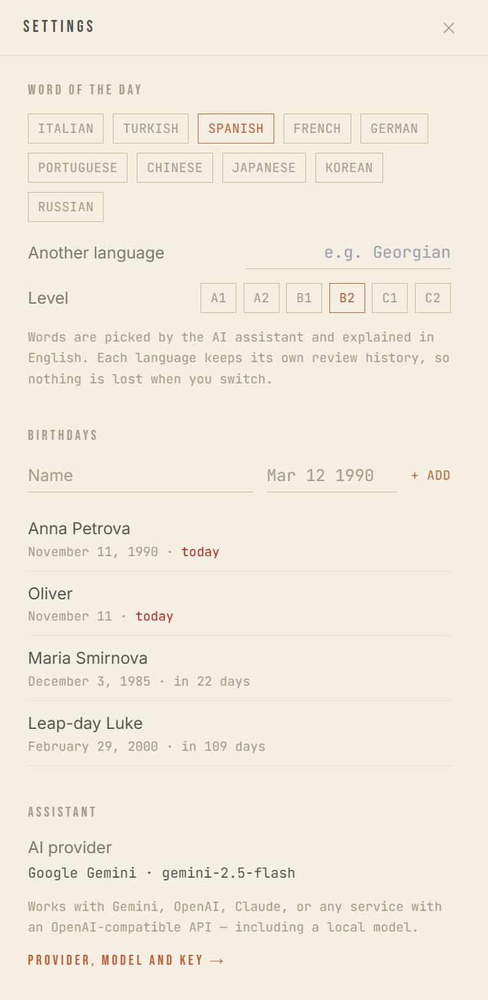

# Sandhour

A small, quiet day planner that lives on your desktop. One narrow window, a
desert palette, no accounts and no cloud — your tasks stay in a local SQLite
file on your machine.

<p>
  
  
  
</p>

## What it does

- **Today** — a short list for the day. Mark up to three tasks as the day's
  priorities; whatever is left unfinished at 23:59 moves to the Attic by itself,
  so every morning starts clean.
- **Calendar** — a month grid. Click a day to add a task for that date; when the
  day comes, the task shows up in Today.
- **Plans** — things you want to do but have not dated yet. Give a plan a date
  and it becomes an ordinary task.
- **Attic** — everything that was not finished on its day. Search it, bring a
  task back, or delete it for good.
- **Inbox** — press `Ctrl+Shift+I` in any application to jot down a thought
  without leaving what you are doing. Sort it out later.
- **Morning ritual** — once a day: pick your three main tasks, and optionally
  pull something back from the Attic.
- **Word of the day** — one word a day in the language you are learning, with a
  translation, an example and its key forms. Each word comes back every two
  weeks, four times in total. Spanish by default; pick any other language in
  Settings.
- **Birthdays** — keep a list; on the day a red reminder appears at the top of
  Today and the date is marked in the calendar.
- **Assistant** — a chat that can see today's tasks and help you plan the day.
- Dark and light themes, always-on-top, lives in the system tray.

## Typing dates

Anywhere you add a task, a date or time at the **end** of the text is picked up
and removed from the task's name. A hint on the right shows what was understood
before you press Enter.

| You type | It becomes |
| --- | --- |
| `call the workshop tomorrow 3pm` | "call the workshop", tomorrow, 15:00 |
| `gym fri` | the nearest Friday |
| `follow up +3` | three days from now |
| `gifts dec 20` · `gifts 20 dec` | December 20 |
| `party 12/25` | December 25 (slash = month first) |
| `party 25.12` | December 25 (dot = day first) |
| `renew passport 2027-01-05` | that exact day |
| `lunch noon` · `standup 9:30` | a time today |

Editing a task works the same way: add `tomorrow` to the end of a task in Today
and it moves to tomorrow.

## The AI part is optional

Word of the day and the assistant need a language model; everything else works
without one. In **Settings → Assistant** choose a provider and paste your own
API key:

- **Google Gemini** — has a free tier, the easiest way to start
- **OpenAI**
- **Anthropic Claude**
- **Other** — any service with an OpenAI-compatible API: OpenRouter, Groq,
  DeepSeek, Mistral, or a model running on your own machine through Ollama or
  LM Studio (no key needed)

Keys are kept per provider, so switching does not lose them.

> Only the Gemini path has been tested against the real service so far. The
> other providers follow their published APIs but have not been exercised with
> live keys — if one misbehaves, please open an issue with the error text.

## Your data

- Everything is stored locally in
  `%APPDATA%\com.sandhour.app\sandhour.db` (SQLite).
- On the first launch of each day the app copies the database to
  `Documents\Sandhour\backups` and keeps the last 14 copies.
- Nothing is sent anywhere unless you set up an AI provider. With one, the app
  sends the word-of-the-day request and your chat messages to that provider,
  plus — only if you leave the boxes ticked — today's task list and the number
  of tasks in the Attic.
- API keys are stored in that same local database, **unencrypted**. Anyone who
  can read your user profile can read them.

## Install

There are no prebuilt downloads yet — build it from source (below). The result
is a regular Windows installer.

The installer is not code-signed, so Windows SmartScreen will warn on first run:
choose **More info → Run anyway**.

Sandhour has only been built and used on **Windows 10/11**. It is a
[Tauri](https://tauri.app) app, so macOS and Linux builds should be possible,
but nobody has tried them yet.

## Build from source

You need [Node.js](https://nodejs.org) 20+, [Rust](https://rustup.rs) and the
[Tauri prerequisites](https://tauri.app/start/prerequisites/) for your system.

```bash
npm install
npm test              # logic tests (date parsing, birthdays, settings)
npm run tauri dev     # run the app with hot reload
npm run tauri build   # produce the installer in src-tauri/target/release/bundle
```

## How it is built

- **Shell** — Tauri 2 (Rust): window, tray, global shortcut, single-instance
  guard, daily backup, the 23:59 rollover timer.
- **UI** — React 19 + TypeScript + Vite, Tailwind CSS, Zustand stores,
  Framer Motion.
- **Storage** — SQLite through `tauri-plugin-sql`, queried with Drizzle ORM.
  The schema lives in `src-tauri/src/migrations.rs`, mirrored for the frontend
  in `src/services/database/schema.ts`.

```
src/
  components/   UI, grouped by feature (tasks, attic, inbox, vocab, birthdays, ai…)
  stores/       Zustand stores — one per feature, each owns its queries
  services/     database client, AI providers, schedulers, word of the day
  utils/        date and birthday logic (pure, covered by tests)
src-tauri/      Rust side
tests/          dependency-free tests for the pure logic
```

## Known limits

- The quick-capture shortcut (`Ctrl+Shift+I`) cannot be changed yet.
- No auto-update.
- The interface is English only.
- Times are shown in 24-hour format; weeks start on Monday.

## License

[MIT](LICENSE)
